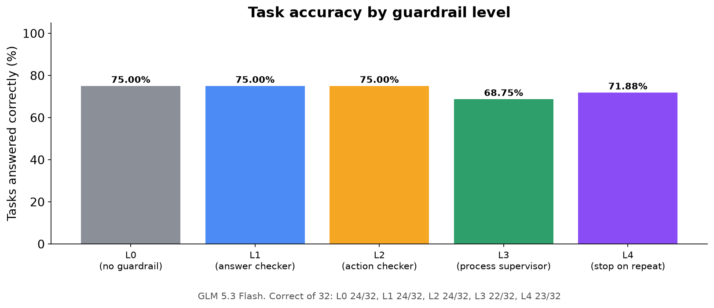
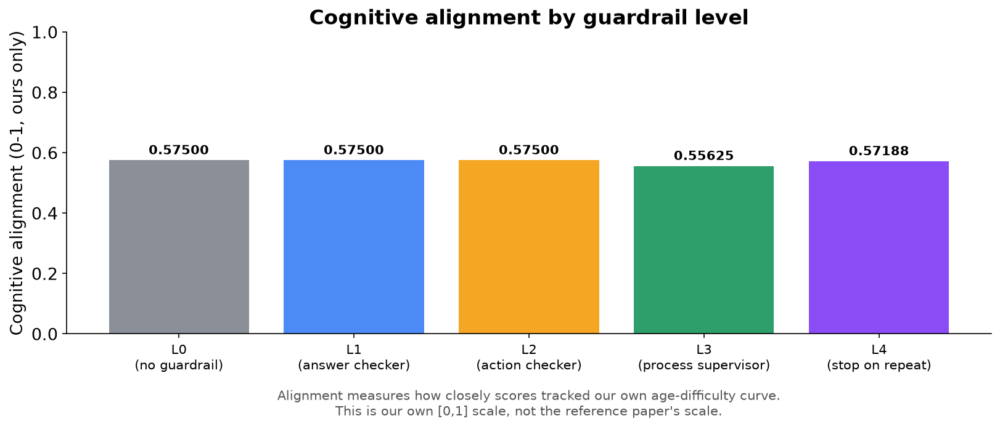
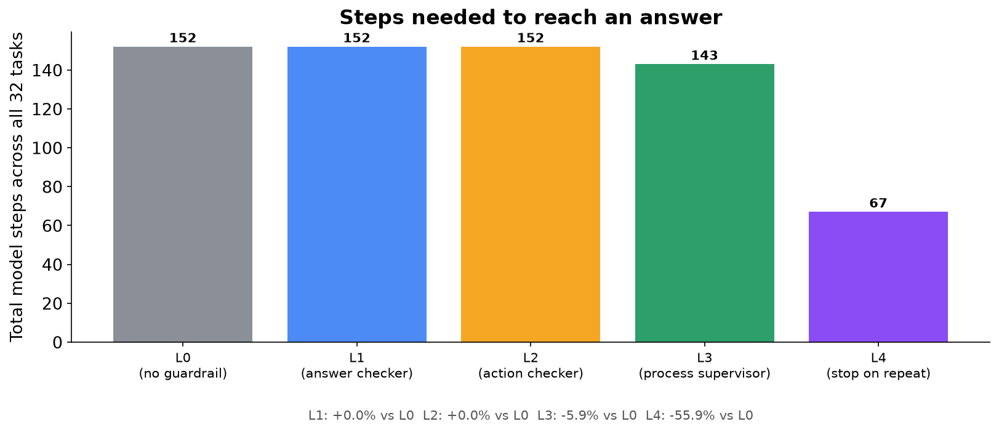
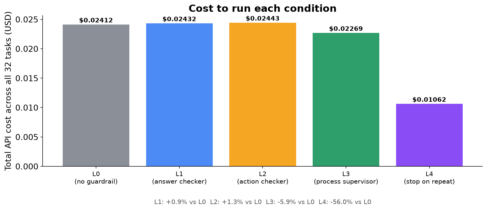
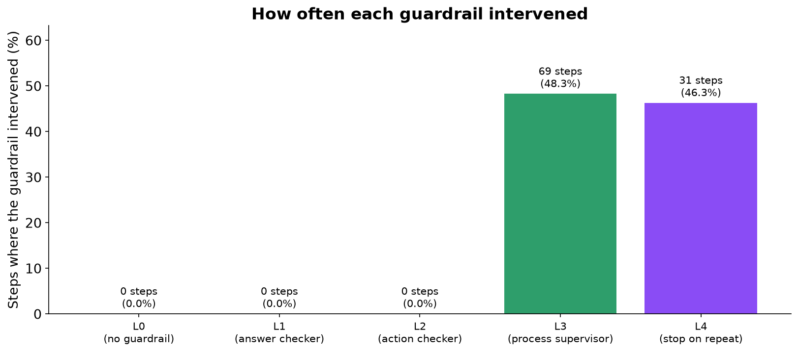
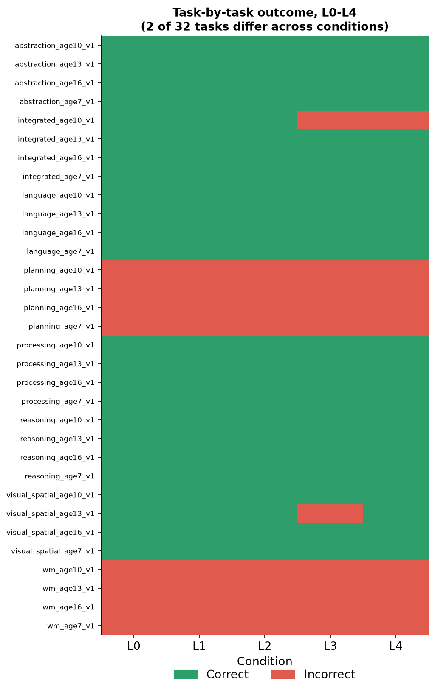
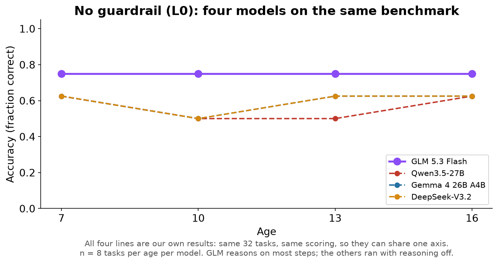
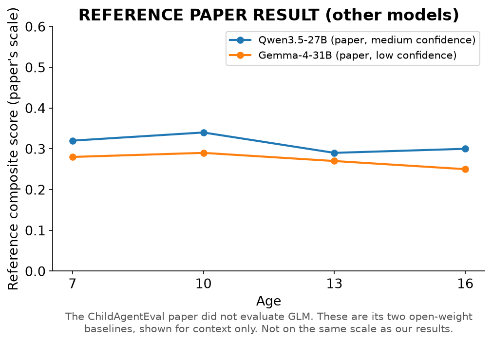
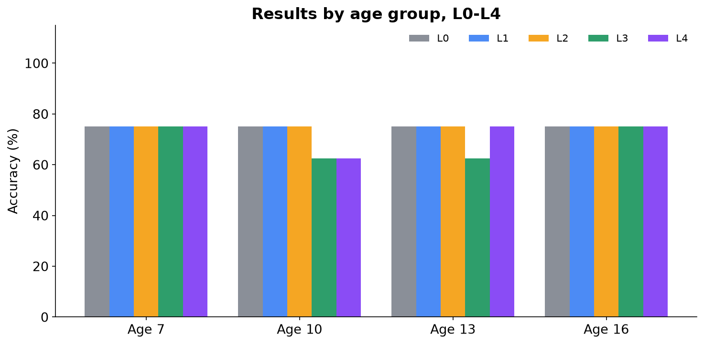
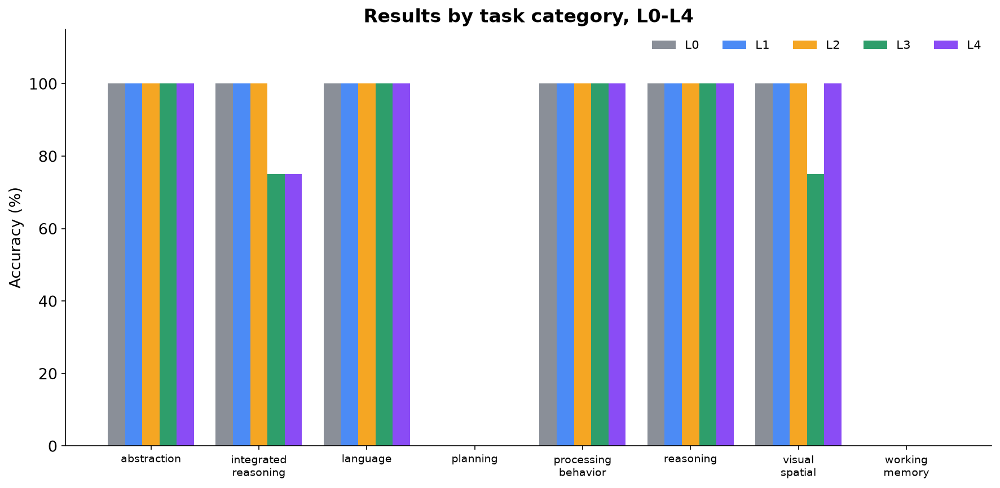

# Can Cognitive Guardrails Change AI Behavior?

### An Experimental Study with GLM 5.3 Flash — L0 through L4

> This is an **independent, original benchmark** inspired by the publicly described research direction of the ChildAgentEval paper. It is **not a reproduction of ChildAgentEval**. It is the same 32-task benchmark and the same guardrails previously run on Qwen3.5-27B, Gemma 4 26B A4B and DeepSeek-V3.2, now run on a fourth model. **The original paper did not test any GLM model**, so there is no paper result for it. **Unlike the other three models, GLM 5.3 Flash cannot have its reasoning switched off**; this is flagged wherever it matters.

---

## Page 2 — The Research Question

**Do supervision systems ("guardrails") change what an AI agent actually does, or only how it gets there — and does the answer hold for a model that thinks before it acts?**

```
   AI Agent  --works on-->  Task  --produces-->  Behavior
                                                      |
                                      Guardrail watches / intervenes
                                                      |
                                                      v
                                                   Outcome
```

We gave GLM 5.3 Flash the same 32 tasks and the same five levels of supervision (L0–L4) used for the other three models, and measured what changed: **the answers it gave**, and **the path it took to get there**.

---

## Page 3 — Why This Matters

AI agents are increasingly trusted to click buttons, fill in forms and complete multi-step tasks on their own. If you add a layer that checks the agent's output, its actions, or its overall behaviour, does the agent actually perform better, or does it just look more supervised?

Three models have already given the same answer, but all three were answering instantly, without reasoning first. GLM 5.3 Flash always reasons before it answers, which makes it a different kind of test: does a model that thinks behave differently under supervision?

> This study repeats the measurement on GLM 5.3 Flash under the same controlled conditions and compares all four models directly.

---

## Page 4 — What We Built

```
 GLM 5.3 Flash  -->  Browser (Playwright)  -->  32 original tasks
                                                         |
                                      L0 / L1 / L2 / L3 / L4 guardrail layer
                                                         |
                                                         v
                                        Accuracy + Alignment + Cost + Steps
```

- **Model:** GLM 5.3 Flash (`z-ai/glm-5.3-flash`) via OpenRouter, temperature 0.
- **The one setting that differs:** the other three models ran with reasoning switched off. GLM's service refuses that ("reasoning is mandatory"), so it ran at the lowest setting available. It still reasoned on about **9 out of 10 steps**.
- **Environment:** a real Chromium browser, driven step by step by the model.
- **Benchmark:** the same 32 original tasks: 8 cognitive categories at 4 target ages (7, 10, 13, 16), one task per category per age.
- **Measurement:** every step, guardrail decision, token (including reasoning tokens) and dollar was logged automatically and scored afterwards.

---

## Page 5 — What Are L0, L1, L2, L3, L4?

Think of them as increasing levels of a supervisor watching someone do a job:

| Level | Analogy | What it actually checks |
|---|---|---|
| L0 | No supervisor | Nothing. The agent works alone. |
| L1 | Answer checker | Rejects malformed or broken output format before it's used. |
| L2 | Action checker | Rejects invalid or clearly premature actions (e.g. giving up on step 1). |
| L3 | Process supervisor | Watches the whole trajectory: if the agent repeats itself, it inserts a pause; after 5 steps it ends the task. |
| L4 | Stop-on-repeat supervisor | Same as L3, except that the moment the agent repeats itself, it ends the task immediately instead of pausing. |

L0 is the plain baseline every other condition is compared against.

> **Guardrail**: an automatic check that inspects an AI agent's output or behaviour and can reject, correct, or redirect it before it counts as final.

---

## Page 6 — How the Experiment Worked

- **32 tasks × 5 conditions (L0–L4) = 160 task runs**, plus a 2-task check run beforehand.
- Every task was run once under each condition, one condition after another.
- Everything was held identical across conditions **except which guardrail was active**.
- All 160 runs completed in full, with no retries and no errors. Total cost: **$0.11**.

> **Reasoning tokens**: words a model "thinks" privately before giving its answer. You pay for them, but they aren't part of the answer. About 90% of everything GLM wrote was reasoning.

> **Baseline**: the no-intervention condition (L0) that every other condition is compared against.

---

## Page 7 · Primary Result — Accuracy



### Guardrails did not improve accuracy, and the small drops were not caused by them.

**[Our Result]** L0, L1 and L2 each got **24 of 32** tasks right, on exactly the same tasks. L3 got 22 and L4 got 23. We traced each lost task:

- The one task L4 lost was a task where **L4 never stepped in**.
- On the two tasks L3 lost, the model was shown **exactly the same thing at every step** as under L0, and simply clicked a different final answer.
- All three are the two tasks where GLM already changes its mind mid-task even with no supervisor at all, so their result depends on which answer happens to come last.

---

## Page 8 · Primary Result — Cognitive Alignment



### No guardrail-driven change in cognitive alignment.

> **Cognitive alignment**: our own measure of how closely an agent's per-age performance tracks the difficulty curve the benchmark was designed around, as a single [0, 1] score. It is **not the same scale as the reference paper's composite score**.

**[Our Result]** Alignment was **0.575** in L0, L1 and L2, 0.556 in L3 and 0.572 in L4. These are the same task-level changes explained on Page 7. GLM's 0.575 is the highest of the four models, because it got more tasks right.

---

## Page 9 · The Interesting Result — L3 and L4: Efficiency







### L4 cut the work by more than half, for the fourth model in a row.

**[Our Result]** Only L3 and L4 intervened: **69** and **31** times, almost always because the agent clicked the same button again:

- L3: steps 152 → 143 (**5.9% fewer**), cost **5.9% lower**
- L4: steps 152 → 67 (**55.9% fewer**), cost $0.0241 → $0.0106 (**56.0% lower**), including the reasoning tokens it no longer had to pay for

L1 and L2 recorded **zero** interventions: GLM never produced broken output or an invalid action.

---

## Page 10 — Task-by-Task Result



### 30 of 32 tasks had the same result in every condition.

GLM got every one of the 24 multiple-choice tasks right under L0, L1 and L2, and every one of the 8 multi-step "click these in order" tasks wrong. The only changes are on two tasks (an arithmetic word problem and a rotation puzzle) where GLM wavers between two answers within a single task, even unsupervised.

> Unlike Gemma, GLM was completely consistent between its three unsupervised-equivalent runs (L0, L1, L2): the same result on all 32 tasks, every time.

---

## Page 11 — What Does It Mean?

### What we found

- No guardrail from L1 to L4 caused a change in GLM's answers (paired comparisons, n = 32 tasks, all p ≥ 0.58; 1.0 after correcting for multiple comparisons).
- L4 again cut steps and cost by more than half.
- **All four models now show the same pattern**: guardrails change efficiency, not answers.



**[Our Result]** Without guardrails, GLM is clearly the most accurate: **24 of 32**, against 18–19 for the others (Gemma's and DeepSeek's lines overlap exactly). It is the only model to get every reasoning and visual-spatial task right. **But it is also the only one that reasoned before answering**, so we can't say how much of that lead is the model and how much is the thinking.

**[Our Result]** Even with reasoning, GLM scored **0% on planning and working memory**, failing exactly like the other three: it clicks the first item and then keeps clicking it. Four models, one of them reasoning, failing identically is strong evidence that the problem is the setup (the agent is never shown what it already clicked), not the models.

### What we cannot claim

> > - We cannot compare GLM to the other models as equals: it reasoned and they didn't. > - We cannot place GLM on the original paper's scale: the paper never tested it. > - With one run per condition, a one- or two-task difference can't be told apart from chance.        

### What we learned

**[Hypothesis]** GLM got every multiple-choice task right even at the "age 7" level. DeepSeek, by contrast, made childlike mistakes. Reasoning may override the prompt's instruction to answer like a child of the target age. Plausible, but not proven by this data.

---

## Page 12 — Limitations and Next Steps

### Limitations

- GLM's reasoning couldn't be turned off, so it isn't a like-for-like comparison with the other three models.
- One run per condition; 32 tasks in total.
- L1 and L2 never fired, so their effect is untested, not disproven.
- An original benchmark, not a validated psychometric instrument.
- No paper reference result exists for GLM.

### What to test next

- Give the agent its own action history: four models now fail planning and working memory identically, which makes it the clearest bottleneck in the setup.
- Rerun one of the other models *with* reasoning on, to separate "GLM is stronger" from "GLM was allowed to think".
- Repeat each condition several times per model to measure variability properly.
- Run L5 on all four models once the Qwen L5 design is settled.

> **Closing summary:** on a fourth model, and the first one that reasons, supervision once more changed how efficiently the agent worked without changing what it got right. Reasoning made GLM the most accurate model, but it still couldn't solve the multi-step tasks that every model fails.

---

## Appendix — Additional Data

These figures give context and breakdowns referenced above, using the same real data.

### A1. The paper's open-weight baselines Reference Paper Result



The ChildAgentEval paper (arXiv:2605.17894) reports results for Qwen3.5-27B and Gemma-4-31B as its open-weight models. It has **no result for GLM**. These lines are shown only for the same context as the other reports; they say nothing about GLM and aren't on our scale.

### A2. Results by age group



Correct of 8: L0, L1 and L2 6/6/6/6; L3 6/5/5/6; L4 6/5/6/6 at ages 7/10/13/16. GLM's unsupervised score is exactly the same at every age.

### A3. Results by task category



Perfect scores in six of the eight categories under L0, L1 and L2; zero in planning and working memory in every condition. Integrated reasoning and visual-spatial are where the L3/L4 single-task changes show up.

---

*Independent Interactive Cognitive-Age Benchmark — not ChildAgentEval · GLM 5.3 Flash via OpenRouter (reasoning: minimal, cannot be disabled) · Full technical report: benchmark_report.md*
